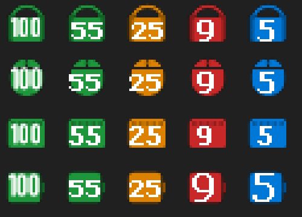

# Battery Info

[English](README.md)

Невеликий застосунок для трею Windows: показує рівень заряду бездротових пристроїв — окрема іконка для кожного, відсоток прямо на іконці. Без фірмового софту і без копання в налаштуваннях чи підменю трею.



*Стилі іконок (збільшено ×4): мишка, навушники, клавіатура, інший пристрій. Зелений — норма, помаранчевий ≤30%, червоний ≤15%, синій — зарядка, сірий — застарілі дані.*

## Що підтримується

Нічого не прописано під конкретні девайси — програма сама знаходить підключене:

- **Bluetooth (класичний і BLE)** — навушники, миші, клавіатури, геймпади тощо. Береться значення, яке Windows сама показує в *Параметри → Bluetooth*. Якщо Windows заряд не показує, програма його теж не побачить.
- **Logitech через приймач** (Bolt / Unifying / Lightspeed) — по протоколу HID++ 2.0, всі спарені пристрої з батареєю.

Тип пристрою (навушники / мишка / клавіатура / інше) визначається автоматично і задає форму іконки.

## Поведінка

- Підключили пристрій — іконка з'являється сама (оновлення при зміні пристроїв і раз на 60 с). Відключили — зникає.
- Сповіщення при 15% і 5%.
- ПКМ по іконці: список знайдених пристроїв (галочка = показувати іконку, запам'ятовується), «Оновити зараз», «Запускати з Windows», «Вихід».

## Встановлення

Завантаж `BatteryInfo.exe` зі сторінки [Releases](../../releases) і запусти. Більше нічого не треба — потрібен лише .NET Framework 4 (є у Windows 10/11), x64. Файл не підписаний, тому SmartScreen може попередити: *Докладніше → Все одно виконати*.

Windows 11 ховає нові іконки в «^» — перетягни їх на панель задач один раз, і вона запам'ятає.

## Збірка

```powershell
.\build.ps1
```

Потрібен лише компілятор, що вже є у Windows (`csc.exe`, .NET Framework 4). Результат — `BatteryInfo.exe`.

Версія задається в `src/AssemblyInfo.cs`. Іконка exe — `assets/app.ico` (перегенерувати: `BatteryInfo.exe --icon assets\app.ico`).

Діагностика: `BatteryInfo.exe --dump "C:\path\dump.txt"` запише знайдені пристрої у файл.

## Обмеження

- Пристрої, які не віддають заряд Windows (деякі колонки, геймпади, AirPods), не показуються — вони використовують власні протоколи.
- Не-Logitech пристрої на власних USB-приймачах (Razer, SteelSeries тощо) поки не підтримуються.

## Ліцензія

[MIT](LICENSE)
